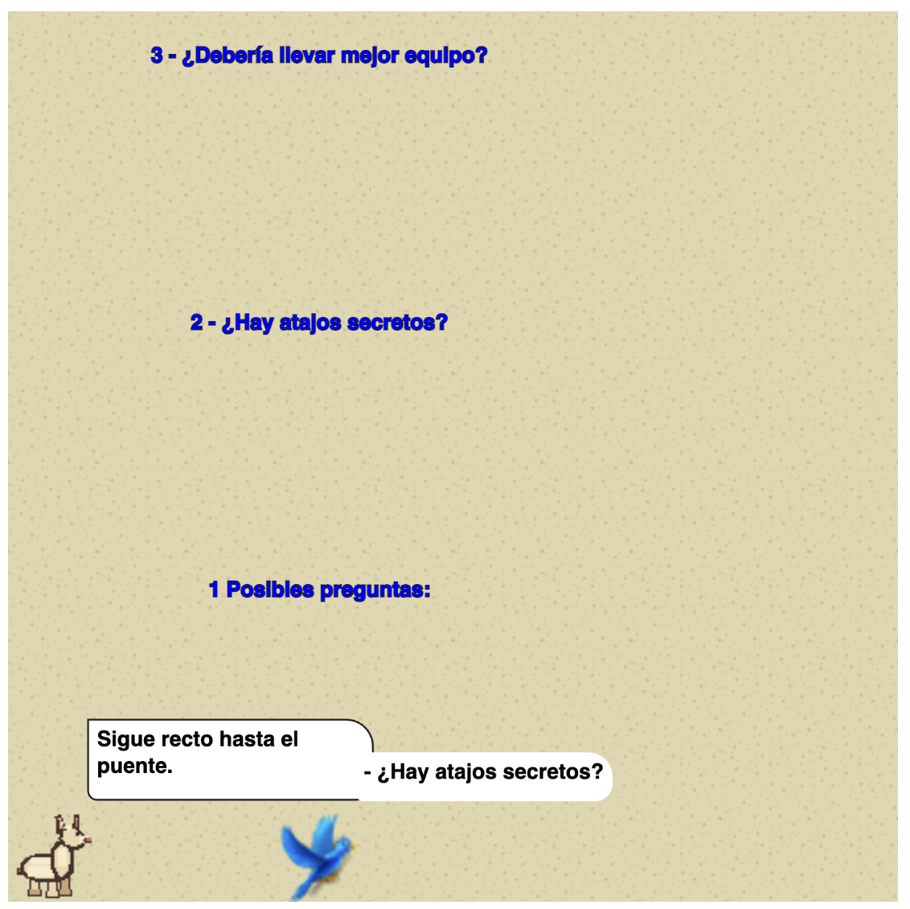

## Hablá con la Llamita

Siempre tenés 3 opciones para decir, la Llama te va a contestar y ofrecer nuevas 3 opciones.

#### Contruí tu historia, cada juego es distinto al anterior!



### ¿Cómo funciona?

La nativa `ollama` envía mensajes al servidor local (`http://localhost:11434`) usando el modelo `gemma4:latest`. 

Desde Wollok:

```wollok
ollama.send("Hola, ¿cómo estás?")
ollama.response()
```

La generación es asíncrona: `response()` devuelve un mensaje de espera mientras
Ollama procesa la consulta. Volvé a llamarlo para obtener la respuesta. Si el
pedido falla, la nativa informa el error al consultar `response()`.
